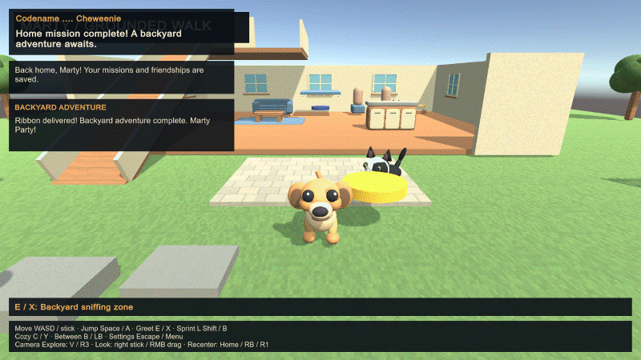

# Cameras, controller controls and pet movement

The 0.8.0 release keeps the original adventure and adds three saved camera presets:

| Preset | View and movement |
| --- | --- |
| Cozy | Stable overview, with the original world-aligned WASD/left-stick movement. |
| Explore | Closer orbit view. Movement follows the view direction. |
| Low | A low third-person view near pet eye level, also with view-relative movement. |

**V / R3** cycles presets. **Right stick** or **right-mouse drag** looks around; looking from Cozy switches to Explore. **Home / RB / R1** recenters behind Marty (or north in Cozy). Preset/distance are saved; orbit angle resets when starting a session. Camera obstruction checks keep the view in front of walls/furniture and ignore Marty's own collider.

In Settings, select the Camera row and press **A/Cross/Enter** to cycle the preset. Left/Right changes distance. Menus use D-pad/left stick to navigate, **A/Cross** to confirm and **B/Circle** to go back. **Menu/Options/Escape** pauses. During button capture, Menu/Options/Escape cancels, so the other face buttons remain bindable. Reset bindings preserves the selected Xbox/PlayStation preset. Camera utility buttons yield to custom action bindings; their menu alternatives remain available.

A light left-stick push now produces a slower walk on level ground and ramps. Full stick moves at the normal pace; B/Circle (default gameplay binding) sprints. Camera input is blocked by pause/title/map views. The HUD and How to Play show the camera controls. Keyboard/mouse controls remain available.

[Actual Low camera render](screenshots/camera-low.png) from the Windows player. The private map HUD is hidden for this public capture.

## Movement and tuning

`GroundedGait` drives visual joint motion from actual root translation and turning. It uses separate walk/trot/run footfall timing, ground probes, stationary stance contacts, paw lift during swing, gentle breathing/body motion, jump tuck and landing compression. It stops advancing the gait when the actor is idle or blocked, and resets contacts on teleport/home recovery. Marty eases turns and Cozy transitions. Cat movement accelerates/decelerates, approaches destinations more slowly and turns gradually instead of snapping.

The clip contains 24 actual gameplay frames, captured after the complete mission/recovery test. Private street geometry and map HUD are hidden during the public recording. It is a short motion sample rather than a seamless animation loop.

The root Rigidbody/capsule still owns locomotion and collision. This is procedural animation of the supplied/articulated static meshes, not a newly supplied skinned skeleton, muscle simulation or motion-captured animation. The meshes remain stylized; a fully skinned artist rig would support finer anatomy and deformation. Original Explorer geometry and photo-guided cat assets are preserved.

Edit the retained `Assets/Resources/Motion/Marty.asset`, `Lakitu.asset` and `Rio.asset` profiles in Unity to change stride lengths, gait thresholds, paw lift, reach, body motion and stretch limits. **Cheweenie > Art > Create missing locomotion profiles** recreates missing defaults without overwriting existing edits. Runtime classes are GroundedGait, LocomotionTuning, MartyModelRig and CatModelRig. Camera/input code is CheweenieCamera, MartyInput, GameControls and the menus. Retain source, profile assets and metadata together.

Automated virtual-device tests cover controller-only start/pause/settings, camera presets/orbit/recenter, view-relative movement, analog speed, planted-paw stability and idle phase. Physical controller hardware/driver behaviour remains a human check. See [actual validation results](VALIDATION.md).
