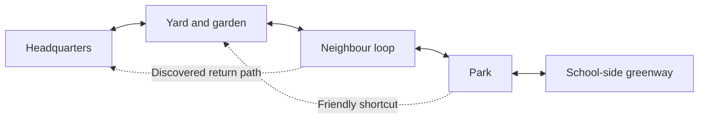

# Codename .... Cheweenie — open-world concept

**Working campaign: Operation Everybody Get Comfortable.**

A tiny dog treats an ordinary neighbourhood like the most important expedition in history. Explore at pet height, follow interesting smells, help the neighbours, uncover ridiculous little mysteries and bring everyone home for a properly earned cuddle. Marty leads with enthusiasm; Lakitu supplies questionable engineering; Rio maintains extremely specific standards.

The promise: **“Go on a little adventure. Make a little mess. Come home together.”**

This is a proposed design and set of editable targets, not a list of completed features. It builds on the playable World 0.10/solo foundation and the separate indoor LAN prototype. Shared outdoor quests, articulated cats and the connected-world systems below still require implementation. Character personalities are proposed fictional comedy roles, not claims about the real pets.

## What the player actually does

Leave headquarters with a loose plan, notice something interesting, solve a small physical problem, help somebody, and return with a story or a new cozy object. A typical outing lasts 10–20 minutes; a quick favour lasts 2–5 minutes. Walking around, barking at a suspicious object and choosing a good nap spot should also feel worthwhile.

The core loop is **explore → sniff/observe → experiment → help or discover → improve the crew's cozy life → explore again**. New favours reveal shortcuts, friendships and home decorations. They do not require grinding a currency before the family can visit the park.

Four priorities guide every addition:

- **Believable pets:** recognizable likeness, grounded paws, natural starts/stops and readable moods. The comedy comes from their decisions and reactions.
- **A neighbourhood worth knowing:** repeated visits reveal changes, familiar neighbours and alternate paths through the same well-made places.
- **Cozy freedom:** optional objectives, forgiving retries, useful rest and a reliable return-home action.
- **A funny crew:** each pet interprets the same situation differently, and their affection remains clear even when they disagree.

## A connected world, built in useful pieces

Start with one continuous neighbourhood rather than a huge empty map. Preserve the owner's optional local street/park/school layout; use a fictionalized public layout in distributable content. Dimensions and routes below are game-design targets, not surveyed real-world distances. School content uses a fictionalized exterior/perimeter and pet adventures, with no pupil identities or school timetable simulation.

| District | Things to do | Discoveries and comic opportunities |
|---|---|---|
| Headquarters | Kitchen meals, sofa hops, TV, toy storage, tricks and blanket fort | Cushion tunnels, a rolling tennis ball, the mysterious disappearance of the warm seat |
| Backyard and front garden | Dig, bury/recover toys, sniff trails, test carrying and gardening favours | A very small hole treated as an archaeological breakthrough |
| Neighbour loop | Meet dogs, return objects, follow connected sidewalks and unlock friendly shortcuts | A mailbox with “suspicious” authority; every dog considers its own fence the important one |
| Park | Toy hunts, gentle obstacle routes, benches, leaves and shared play | A leaf chase that grows into an unnecessarily formal investigation |
| School-side greenway | Finish the first campaign, find scent stories and help set up a cozy gathering | A completely ordinary ball that apparently needs an escort committee |

The first connected slice targets roughly **150 × 150 game metres** across home, yard and a short park approach. A first-release envelope of up to **400 × 400 game metres** is a ceiling for planning, not a content quota. Keep the main home–park–school walk around 350–450 metres, with two loops and useful shortcuts. Tune the envelope to the existing layout and measured traversal before expanding it.

Place a readable activity or discovery about every 20–40 metres along primary routes. A quiet patch is useful between jokes. Use the blue front door, a distinctive park tree, a bench and a school-side landmark for navigation; provide compass, map and route help as optional aids. Fast return home is always available. Visiting an already discovered district can offer a controller-friendly quick-travel option once shared-world travel is reliable.

This diagram describes connections and unlocks, not geographic street positions:

## Three pets, three ways to be helpful

All three can walk, hurry, look around, carry suitable toys, interact, rest and use the core help/recovery controls. They share the critical path. Character-specific approaches open bonus routes or shorten a task; a solo player or any two-pet pairing can finish the campaign.

| Pet | Proposed strengths | Comedy engine | Signature moment |
|---|---|---|---|
| Marty / Mr. Marty / Marty Man / Marty Party / Marty McFly | Scent focus, low passages, soft-earth digging and enthusiastic carrying | Absolute confidence in a very small investigation | **Cheween in Between:** wriggle between cuddling people or into a soft gap; later settle into **Cheeween Cozy** |
| Lakitu / Keetz / Keeterman | Precise feline hops, balance and deliberate paw taps | Insists the accidental result was the original plan | Knocks an object into exactly the useful place, then supervises |
| Rio / Sis / Little Miss / Miss Priss | Quiet approaches, careful inspection, patient paw reach and finding comfortable spots | Rejects the situation, then quietly solves it | A dignified flop holds a soft pressure pad while everyone calls it teamwork |

Marty's squeeze is a soft-space interaction, not a way through arbitrary walls. Cat routes need clear reachable ledges and safe landings. A squeeze/hop/flop puzzle must also have an accessible floor-level solution, a character-switch opportunity, or an explicit NPC assist. Never require a missing third player.

Keep one visible mouth-carried object and the existing four-slot backpack concept, with a shared home stash added later. Use clear carry/drop/bury prompts and distinctive object silhouettes. Energy encourages changing pace and resting; normal walking and home recovery remain available. Health stays a forgiving recovery system, with no combat campaign or unattended/offline decay planned for the first release.

## A first campaign with a reason to roam

The crew is preparing a neighbourhood Cozy Day. A breeze, a rolling toy and several competing “helpful” plans scatter the supplies. Nobody is a villain; the mystery is how three pets made a simple afternoon so complicated.

1. **The Empty Warm Spot:** learn movement, look, interaction and the home stash. Marty discovers that the best cushion has moved an alarming two metres.
2. **Operation Long Dog:** follow a scent into the garden, dig up a toy and open a low shortcut. Teach digging/carrying with a generous hint.
3. **Keeterman's Entirely Intentional Machine:** use a paw tap or a floor-level lever to roll a ball into a gate release. The gate works; Lakitu accepts full credit.
4. **Rio's Comfort Inspection:** find three different resting surfaces. The “best” one changes when a sunbeam moves. Teach rest, observation and optional quiet movement.
5. **The Park Leaf Incident:** help a neighbour find a toy among leaves; test different routes, sniff clues and shared carrying/drop ownership.
6. **The Very Important Ball Escort:** reach the school-side greenway, reunite supplies, then return to a home or park gathering for Cheeween Cozy and a playable free-roam epilogue.

The first release targets these six linked campaign missions plus **14 optional favours**, using at least five activity patterns: observation/scent deduction, physical placement, route finding, social help, and cooperative or NPC-assisted interaction. A favour must change its interaction or story, not only the colour of the object being fetched. Repeatable toy play, digging/recovery, tricks, rest and neighbour greetings continue after the ending.

Rewards are understandable changes: an open shortcut, a new friendship reaction, a blanket pattern, a home display object or a goofy badge. Optional collectibles, provisionally called **Scent Stories**, reveal short environmental jokes rather than essential upgrade currency.

## Comedy that belongs to this crew

Use broad tools shared by observational comedy and family adventures: mismatched confidence, deadpan replies, visual setup/payoff, the rule of three and a running gag that changes. Dialogue and situations here are original. Physical timing and reactions should carry a joke even with dialogue muted.

| Situation | Playable setup and payoff | Sample original line |
|---|---|---|
| Bark briefing | Marty announces the mission; a ball immediately rolls past him | Marty: “Nobody panic. I have smelled this situation before.” |
| Engineering review | Lakitu taps a ball; it opens a latch after a long, worrying pause | Lakitu: “Exactly as planned. Including the waiting.” |
| Mud inspection | Rio walks around a tiny puddle; Marty makes the proudest possible splash | Rio: “I requested a shortcut. This is a wetcut.” |
| Backpack discovery | A recovered treasure is the toy buried earlier | Marty: “Ancient treasure! From earlier!” |
| Sofa summit | The crew reaches the cushion; Marty squeezes into the remaining gap | Rio: “There was no space.” Marty: “I brought some.” |
| Leaf escalation | One leaf becomes three, then a gust interrupts the debrief | Lakitu: “We have contained the incident.” Rio: “The incident is behind you.” |
| Questionable evidence | Marty proudly carries the object the group was already using | Lakitu: “Good news. We found the evidence table.” |
| Comfort audit | Rio tests a cushion, changes position once, then closes her eyes | Rio: “This inspection may take the rest of the afternoon.” |
| Official measurement | A pretend investigation uses pawprints as its unit | Fox Ellis, Chief Sniff Inspector: “The suspect is approximately one suspicious thing tall.” |
| Closing ceremony | The crew earns a badge and immediately lies on it | Leo Ellis, Blanket Boss: “Meeting adjourned. Nobody move. Especially me.” |

Running gag: Marty believes every mystery involves a squirrel. The first clue is a leaf, the second is his own toy, and a real squirrel finally appears during an unrelated conversation. It leaves without explaining anything. The squirrel is a proposed optional ambient character, not an existing AI feature.

Keep action barks short, provide readable captions, and save longer exchanges for pauses or completion beats. Default to no repeated identical joke inside ten minutes and at least 15 seconds between spoken comedy beats. Mission cues take priority. Idle chatter is sparse, with separate controls for dialogue, captions and ambient comedy; muting it never hides an objective. Gentle slapstick has quick recovery and affectionate reactions.

## Solo and two-player design

Solo offers pet switching at safe moments and simple companion follow/stay/assist commands. Two-player LAN lets each person choose an unclaimed pet, with independent cameras and local settings. Any pairing must work: Marty + Lakitu, Marty + Rio, or Lakitu + Rio. Three-player play is a stretch objective after two-player outdoor play, saves and reconnects are proven.

First extend the existing shared indoor toy into one authoritative outdoor toy/favour. The host owns object state, quest progression and the shared-world checkpoint. A guest owns local preferences and pet selection; do not overwrite their solo campaign. Simultaneous pickup has one winner, with a clear response for the other player. Dropped, carried, stashed and buried states must be mutually exclusive and survive a host save/reload.

A player opening controls does not freeze their friend. Story dialogue can remain captioned while both move. Shared door/district travel needs an explicit “join friend” action or a visible group-ready choice, with a recovery route for someone who stays behind. Reconnect at a safe checkpoint and release carried objects safely on disconnect. Test real separate PCs before describing this as verified home-LAN play. Internet matchmaking and host migration are outside the first-release target.

## Goals and measurable targets

These are proposed acceptance targets. Current verification results remain in the existing build evidence; none of the targets below are claimed achieved by this document.

| Goal | Target | Evidence required |
|---|---|---|
| Easy first play | Start/continue within three deliberate menu selections; first satisfying interaction within two minutes | Five fresh-start play sessions; four meet both targets without outside instruction |
| Clear onboarding | First favour within five minutes; movement/look/interact/carry introduced within ten | Recorded keyboard and physical-controller walkthroughs; log hints used |
| Interesting connected slice | Home, yard and park approach; two loops; six authored discoveries and three favours | Full route walkthrough, reachable-object audit and actual screenshots |
| First-release content | Five districts, six campaign missions, 14 optional favours, at least five activity patterns | Content inventory and completion/reload runs; zero mandatory unreachable steps |
| Navigation | Main routes have a legible next landmark or optional guidance; home recovery succeeds everywhere | Test each district, shortcut and transition with map/route overlays both on and off |
| Pet likeness and motion | Owner-reviewed front/side/three-quarter views; walk/trot/turn/stop/jump/rest for all three | Actual in-engine clips against retained references; physical-controller review |
| Grounded animation | Aim for under 2 cm obvious paw penetration and under 3 cm planted-foot drift over one second on five test surfaces | Instrumented contact samples plus slow-motion visual review; tune per pet |
| Controller comfort | Core loop, menus, inventory, pet selection and recovery work without a mouse | Full campaign slice on physical Xbox and PlayStation controllers; keyboard regression too |
| Two-player correctness | Three pairings finish the slice; 100 contested carry/drop trials cause zero duplicated/lost items | Two physical PCs, host/guest role swap, disconnect/rejoin and save/reload tests |
| Network resilience | Remain usable at 80 ms simulated round-trip delay and 1% packet loss on the slice | Record actual emulation settings, corrections, item ownership and recovery results |
| Performance | Proposed 1080p Medium/60 FPS target on a named reference PC; 720p/30 fallback profile | Record hardware first; 10-minute warmed indoor/outdoor/co-op routes, frame-time distribution and settings |
| Frame-time quality | For the 60 FPS profile: aim for p95 ≤20 ms, p99 ≤33.3 ms; no gameplay hitch over 100 ms on the measured warm route | Frame capture distinguishing loading, shader warmup, CPU/GPU and background activity |
| Reliable saving | No lost completed favour or owned item across three save/reload cycles and one forced shutdown recovery | Versioned checkpoint tests; retain a previous known-good save |
| Family-friendly comedy | At least one optional character-specific payoff per favour; dialogue mute preserves comprehension | Caption/audio-off walkthrough and family feedback; edit jokes that interrupt play |
| A shareable demo | Complete packaged folder, simple launchers, no editor dependency, current hashes and no private data in transfer ZIP | Fresh launch on a second Windows PC and archive inspection |

Size/content limits are ceilings to protect quality. Do not expand the map to meet an area number if the existing places still lack interesting play. Performance targets require qualification on recorded hardware; the current offscreen diagnostics are not proof of these targets.

## Ordered delivery gates

The roadmap below translates this concept into implementation gates. Continue the handoff's unfinished pet/companion work before expanding the whole neighbourhood. Retain the current builds throughout. Gate IDs are stable in [the structured backlog](OPEN_WORLD_TARGETS.json); work is planned until acceptance evidence exists.

| Gate | Deliverable | Exit condition |
|---|---|---|
| OW-00 — baseline | Record reference hardware, traversal timings, save schema and a repeatable test route | Reproduce the current packaged build; label real/synthetic input; capture frame times and retain rollback artifacts |
| OW-01 — believable crew | Finish cat rigs/gait and review all three pets against references; preserve Marty secondary ear motion | Three in-engine reference turnarounds and required movement/rest clips pass review; existing gameplay/control regressions pass |
| OW-02 — connected slice | One continuous home–yard–park approach with navigation and interaction placement | Three favours/six discoveries, two route loops and reliable home recovery; solo save/reload and controller walkthrough pass |
| OW-03 — outdoor duo | Shared toy, one shared favour and one district transition for every two-pet pairing | Separate-PC ownership, transition, disconnect/rejoin and checkpoint tests pass; guest solo data remains independent |
| OW-04 — campaign neighbourhood | Extend to neighbour loop and school-side greenway; implement the six-part campaign and 14 favours | Content and navigation targets pass in solo and supported co-op; family play review finds no blocking objectives |
| OW-05 — polish and distribution | Tune art/lighting/audio, scalability, accessibility and comedy pacing | Hardware-qualified performance/control targets and packaged second-PC launch pass; archive/provenance evidence is current |

Defer vehicles, combat, a city-sized map, procedural mission generation, three-player expansion, live-service systems and internet matchmaking until these gates are stable. The next focused implementation task is **OW-00 baseline qualification followed by OW-01 cat articulation**, using the retained photo brief and current character sources. This concept does not itself replace validated build evidence or authorize calling planned systems complete.
