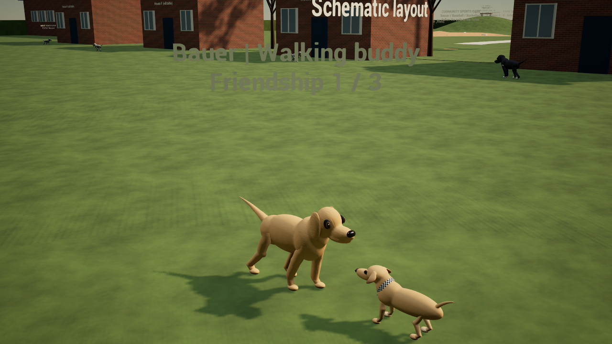
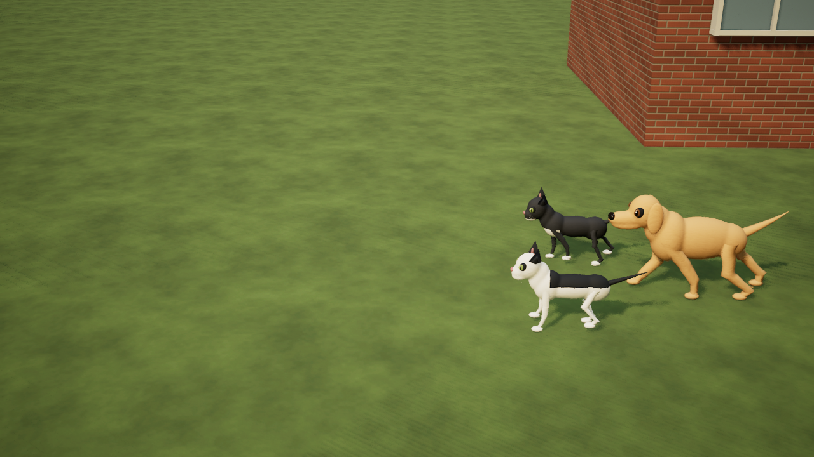
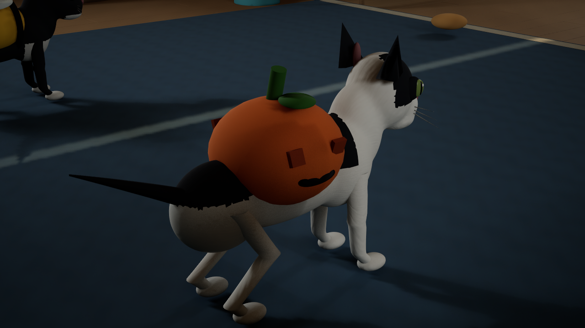

# Codename .... Cheweenie — articulated dogs and cats

Development source, November 12, 2026. Continues the cumulative neighbourhood NPC game in `D:/CheweenieValidation/NeighbourDogs`, branch `codex/articulated-dogs-and-cats`. Desktop packages are unchanged.

## What changes

The neighbourhood dogs now use original smooth, skin-weighted models in place of the separate oval parts and swinging rigid legs. Each has four articulated chains: shoulder/hip, elbow/stifle, wrist/hock and paw. Connected torso surfaces deform through pelvis, spine, chest, neck and head joints. Ears and a three-joint tail provide secondary motion. Bauer remains golden, Hank larger and black/white; Georgia/Pieper use a shared neutral potcake placeholder until their coats are supplied.

Lakitu and Rio now have separate feline skins with upright ears, smaller muzzles, slit pupils and tapered whiskers. Lakitu retains a white face/chest, black ears and left-eye patch. Rio retains a black face, white chin/chest and white whiskers. The original static meshes and actor identities remain intact as retained resources; the new skins supply the visible animation. The same feline visuals work for playable cats in room mode, including an airborne paw tuck. The separate Lakitu actor in Hockey Bag Surprise uses the same rig and a tucked-paw reveal hop with a supported landing.

`UAnimalGait` follows actual movement, rather than the requested walking speed. Walk/trot cycles advance with distance travelled; blocked animals stop stepping. Planted paws retain world contacts, swing paws lift and reach forward, and Marty's analytic knee solver prevents inverted or overextended limb chains. Teleports reset contact caches. Cats have a longer stance interval, hind-paw timing close to the previous front-paw print, shoulder sway and extra spine flex as they speed up. Dogs have a heavier body rhythm and blend into a diagonal trot. Idle breathing, head-bump motion and distinct cat/dog tail motion continue without skating paws. Solo menus freeze animation.

Existing greetings, play, walking buddies, saved friendship, cat follow/stay/recall, outfits, keyboard and Xbox/PlayStation bindings remain part of the cumulative game. Clothing now follows the cats' live spine pose. No save format or input mapping changed.

## Sources and limits

Five original 27-joint FBX meshes, generator and manifest live in `Unreal/UE5MovementLab/SourceArt/CompanionRigs`. Free Blender 5 builds them with `Scripts/build_companion_rigs.py`; Unreal imports them with `Scripts/import_companion_rigs.py`. Original project coat detail is reused in skeletal-compatible materials. `/Game/Adventure` already belongs to the package's always-cook directories.

The result is stylized anatomical animation closer to Marty, not scanned likenesses or final photoreal fur. Character scale/proportions and gait still benefit from owner review. No measured performance improvement is claimed. Unity and the independent comparison preview were not changed.

## Actual verification

Native UE 5.8.4 Editor compilation and import of all five rigs passed. The final module passed **254 real-map assertions**: 32 dog NPC, 33 cat companion + four reload, 48 host + 46 guest, 51 costume + three reload, 20 movement and 17 hockey-story checks. The new assertions cover joint bending, torso deformation, world paw contacts, animation pause, local/remote feline rigs, playable-cat jumping and story hop/landing.

The final dog/companion/room/costume/movement/story suites all ran again after story integration. Seven rendered stills and sampled stride frames were reviewed. A **five-second, 120-frame native walking preview** encoded at 24 fps and passed a full decode. It uses scripted staging/movement and camera; this is not a performance benchmark. The preview is written to `Unreal/UE5MovementLab/Saved/AnimalMotionReview/AnimalMotion.mp4`.

All ten final gameplay/capture logs had zero Error/Fatal, material-fallback or VSM-overflow scan matches. [Reports, module/source/asset hashes and capture evidence](evidence/ue5-animal-articulation.json). Physical controllers, separate-PC networking, comparative performance and a newly cooked standalone package remain unverified. Unity checks were not rerun because its source/assets/settings were unchanged.







Reproduce from the development checkout:

```powershell
& ./Unreal/UE5MovementLab/BUILD.ps1
& ./Unreal/UE5MovementLab/TEST_DOG_NPCS.ps1 -Render
& ./Unreal/UE5MovementLab/TEST_COMPANIONS.ps1
& ./Unreal/UE5MovementLab/TEST_COSTUMES.ps1 -Render
& ./Unreal/UE5MovementLab/TEST_COOP.ps1 -Port 19471
& ./Unreal/UE5MovementLab/TEST.ps1
& ./Unreal/UE5MovementLab/TEST_HOCKEY.ps1 -Render
& ./Unreal/UE5MovementLab/CAPTURE_ANIMAL_MOTION.ps1
```
