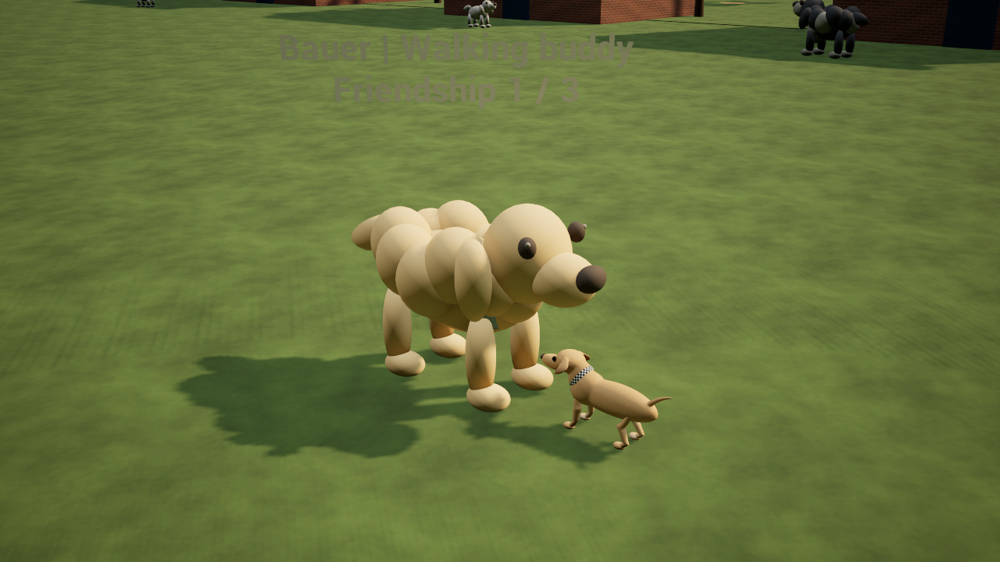
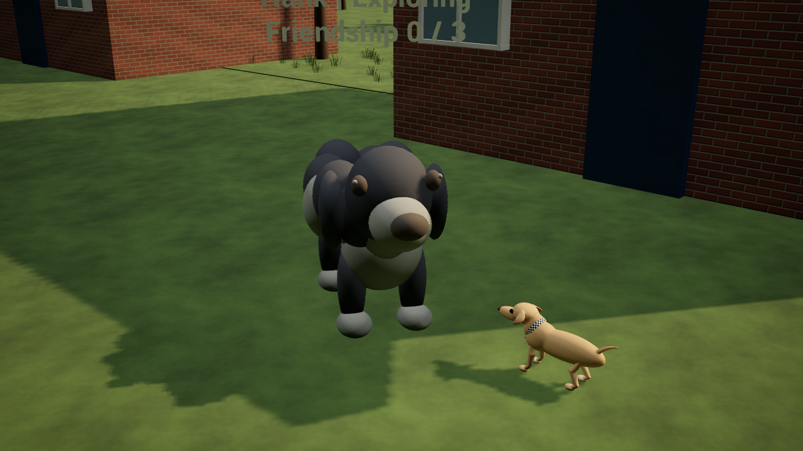
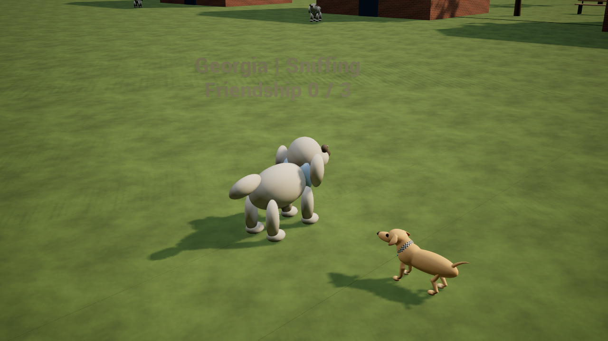

# Codename .... Cheweenie — neighbourhood dog NPCs

Development source, November 12, 2026. Implemented in `D:/CheweenieValidation/NeighbourDogs`, branch `codex/neighbour-dog-npcs`, using cumulative main plus the retained wardrobe attachment optimization. The unrelated unfinished Toy Thief edits in `Validation/SportsParkReview` remain preserved; they are not part of this branch. Desktop packages and launchers have not been updated.

## Playing

Go outside and approach a neighbour. Use **E / Xbox X / PlayStation Square** for the action shown:

1. Say hello. The dog turns to Marty and pauses for a friendly sniff.
2. Offer a play bow. Your buddy bounces into a short chase around Marty; friendship increases to a saved maximum of three.
3. Invite a walk. The dog follows behind Marty and stops nearby when he stops.
4. Say goodbye. Your buddy heads back toward its home garden.

The greeting/play/walk sequence is available on repeat visits. Interaction has a short cooldown, and meeting the same neighbour keeps the existing unique meeting count. Only one neighbourhood dog walks with Marty at a time; inviting another sends the previous buddy home. Lakitu and Rio keep their own companion controls. Dogs do not take, carry or alter Marty's toys.

Dogs roam around their gardens and stop to sniff. They wait when Marty approaches, turn toward him, and animate their legs, heads and tails. Bauer has a golden fluffy silhouette; Hank is larger, black and white, and fluffy. Georgia and Pieper use leaner neutral placeholder models: their actual coat colours and markings remain unknown. All models are original primitive-based stylizations, not final likenesses or skeletal fur assets. The remaining editable neighbour slots use the same NPC loop. Existing local name and house-label overrides still load.

Menus freeze behavior and interaction timers. Nearby labels show activity and friendship and respect the World labels feature switch. Returning indoors resets outdoor visits and positions while preserving friendship. A buddy more than 16 metres from Marty, or on a different floor, stops following and heads home; landmark travel does not teleport a dog alongside Marty.

## Implementation and limits

`NeighbourDogs.cpp` extends the existing native neighbourhood component with roaming, sniffing, greeting, play, following and return states. It uses ground probes and body sweeps against static world geometry, with alternate steering directions around obstacles. Movement uses short bounded steps and rejects steep or missing ground. This is local steering rather than a complete navmesh planner: complex enclosed routes and arbitrary private-map obstacle layouts are not guaranteed. Dogs have no blocking collision with Marty. Outdoor NPCs belong to solo mode; this does not add replicated outdoor multiplayer NPCs.

The save adds `NeighbourDogBonds` without renumbering existing meeting bits or changing other progress. Missing arrays default to zero, loaded values clamp to 0–3, and existing neighbour indices remain stable.

## Verification

Native UE 5.8.4 Editor compilation passed. The final binary passed **59 real-map assertions**: 27 rendered NPC checks, 12 headless outdoor checks and 20 headless movement checks. The NPC run exercises keyboard greeting/invitation and synthetic controller play/goodbye, autonomous movement, pause, wall clearance, floor isolation, buddy replacement, capped friendship and a real disk save round trip. All three final runtime logs had zero Error/Fatal, material compilation fallback or VSM-overflow matches. Three actual 1280×720 captures were reviewed. [Reports, source/module hashes and capture hashes](evidence/ue5-dog-npcs.json).

The initial NPC runs each passed 26/27 and exposed an undersized clearance probe. It now scales with the whole enhanced silhouette; the final wall check passed. These are automated checks with staged teleport fixtures, not physical controller gameplay. Complex private-map routing, physical controllers, comparative performance and a new standalone package remain unverified. Unity source, assets and settings are unchanged.

The illustrated bodies remain prototypes. World labels use the retained world-text rendering; contrast and framing can still benefit from further visual polish.







```powershell
& ./Unreal/UE5MovementLab/BUILD.ps1
& ./Unreal/UE5MovementLab/TEST_DOG_NPCS.ps1 -Render
& ./Unreal/UE5MovementLab/TEST_OUTSIDE.ps1
& ./Unreal/UE5MovementLab/TEST.ps1
```
