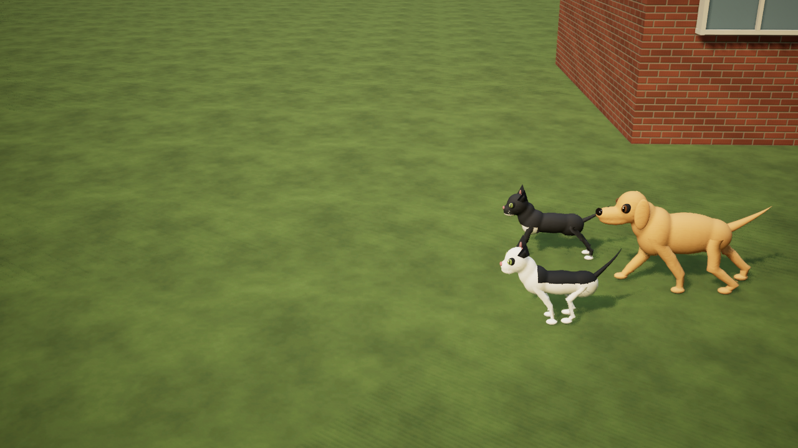

# Codename .... Cheweenie — distinct feline movement

Development source, November 13, 2026. Continues the combined companion PR #60 in `D:/CheweenieValidation/NeighbourDogs`. Desktop packages are unchanged.

Cats now have a deliberate locomotion policy beyond small timing changes to the dog cycle:

- At walking speed, a hind paw can target an earlier same-side front-paw print. The target stays fixed during swing. A small overlapping offset, reach guard and footprint-history reset prevent stretching or following an obsolete print after a recall or sharp turn.
- A narrower paw track, lower swing arc and smooth acceleration into each paw placement replace the canine stepping arc.
- Front-limb attachment points glide independently with each step. A low-bounce torso, opposing shoulder/pelvis motion and head stabilization keep the walk supple rather than dog-like bobbing.
- The cat tail is carried and softly curled, with turn-dependent counterbalance. It does not reuse the dog's friendly wag.
- A moderate-speed diagonal trot remains available. At faster catch-up speeds, feline fore/hind timing and stronger spinal flex blend toward a paired running style instead of converging on the canine trot.

The existing weighted meshes, knee/hock solver, grounded paws, idle breathing, head bumps, jumping and menus remain integrated. The canine walk/trot and wag style is retained. The shared component automatically applies the feline policy to Lakitu and Rio in solo and room mode, and to story Lakitu in Hockey Bag Surprise. Halloween remains explicitly opt-in on every launch.

The motion is an original procedural game approximation. Rates, stride lengths, overlap distance, poses and transitions are tuned for these stylized rigs; they are not measured biomechanics or a claim that every cat and dog uses a different footfall pattern at every speed.

## References

The design is informed by primary work on [cat forelimb/scapular movement](https://pubmed.ncbi.nlm.nih.gov/1164673/), [paw trajectory stabilization](https://pmc.ncbi.nlm.nih.gov/articles/PMC4137248/) and [accurate stepping/full-body mechanics](https://pubmed.ncbi.nlm.nih.gov/20164404/). No figures, animation clips, geometry or third-party code were copied.

## Verification

Native UE 5.8.4 Editor compilation passed. **268 final real-map assertions passed**: 14 matched-speed species, 33 companion play + four reload, 32 dog NPC, 48 room host + 46 guest, 17 hockey, 20 keyboard/synthetic-gamepad movement and 51 rendered wardrobe + three reload. The species comparison uses matched-speed actor-transform fixtures, not human gameplay or measured biomechanics. Room tests use two local processes. Physical controllers, separate-PC networking, comparative performance and an updated desktop package remain unverified. Unity source/assets/settings are unchanged.

The walking fixture recorded 22 registered hind swings; sampled hind-paw bone positions were at most 2 cm from a same-side front print. Cat body/head vertical spans and tail lateral span were lower than the dog's at the same speed. See [actual reports, metrics and source/native hashes](evidence/ue5-feline-gait.json).

The first concurrent cold-start companion run missed the existing acceleration/stride timing checks (31 passed, two failed). The unchanged-source warm rerun passed all 33 play and four reload checks; the initial failure is retained in the evidence.

A native 120-frame preview encoded to five seconds at 24 fps and fully decoded. Frames 32, 75 and 112 were reviewed, along with both rendered cat costumes. This screenshot sequence does not measure real-time frame rate; Marty leaves the camera's left edge while the companions remain visible. Eleven final logs had no Error/Fatal, material-compilation fallback or VSM-overflow matches.




```powershell
& ./Unreal/UE5MovementLab/BUILD.ps1
& ./Unreal/UE5MovementLab/TEST_SPECIES_GAIT.ps1
& ./Unreal/UE5MovementLab/TEST_COMPANIONS.ps1
& ./Unreal/UE5MovementLab/TEST_DOG_NPCS.ps1
& ./Unreal/UE5MovementLab/TEST_COOP.ps1 -Port 19521
& ./Unreal/UE5MovementLab/TEST_HOCKEY.ps1
& ./Unreal/UE5MovementLab/TEST.ps1
& ./Unreal/UE5MovementLab/TEST_COSTUMES.ps1 -Render
& ./Unreal/UE5MovementLab/CAPTURE_ANIMAL_MOTION.ps1
```
