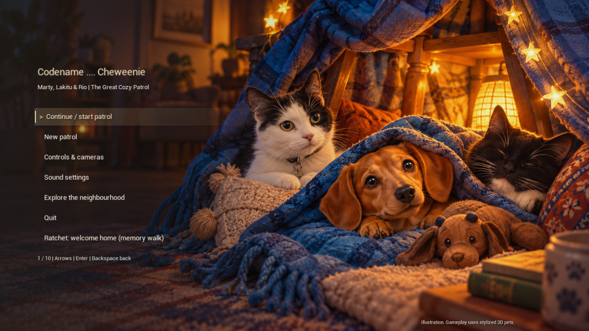

# Codename .... Cheweenie — Halloween opt-in and combined PR

Development source, November 12, 2026. The cumulative companion branch contains the roaming/interacting dogs from PR #59 and the articulated dog/cat models from PR #60, plus the retained wardrobe-cache prerequisite. PR #60 is the consolidated review against main; PR #59 is superseded. Desktop packages are unchanged.

Halloween is now **off on each launch**, including checkpoints saved while the event was active. Ordinary Continue starts the regular adventure. Opening the Halloween menu or its dedicated launcher only opens the menu; choose **Start / continue Bork or Treat** or **Halloween mode: OFF (enable event)** to activate it. Once enabled, Continue within the running session retains the event until it is disabled or the game is relaunched.

The change clears only the runtime `HalloweenActive` flag during checkpoint loading. Stickers, Pumpkin Pal badges, completed-round progress, costumes, main patrol progress, unlocks and other saved settings are retained. Existing wardrobe choices remain independent of the event.

The festival runner now performs three actual game launches: event play writes a deliberately active checkpoint; an ordinary restart checks regular title/Continue and explicit keyboard enable/controller disable; a dedicated Halloween-menu restart verifies that opening the menu still leaves the event off until Start is chosen. Acceptance saves are isolated from owner progress.

Native UE 5.8.4 Editor compilation passed. **134 current real-map assertions passed**: 41 event play, six ordinary restart, six menu restart, 29 mode-hub, 32 dog NPC and 20 movement checks. The ordinary title capture was reviewed; six final logs had zero Error/Fatal, material-fallback or VSM-overflow matches. Inputs were synthetic keyboard/gamepad. [Reports, source/module hashes and capture](evidence/ue5-halloween-opt-in.json). The earlier 254-assertion articulated-animal milestone remains recorded separately. Physical controllers and a new standalone package remain unverified. Unity source, assets and settings were unchanged.

```powershell
& ./Unreal/UE5MovementLab/BUILD.ps1
& ./Unreal/UE5MovementLab/TEST_FESTIVAL.ps1 -Render
& ./Unreal/UE5MovementLab/TEST_MODE_HUB.ps1
& ./Unreal/UE5MovementLab/TEST_DOG_NPCS.ps1
& ./Unreal/UE5MovementLab/TEST.ps1
```


