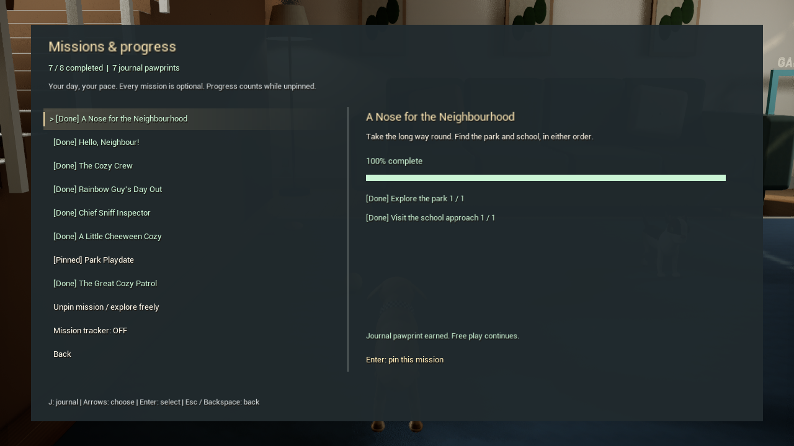
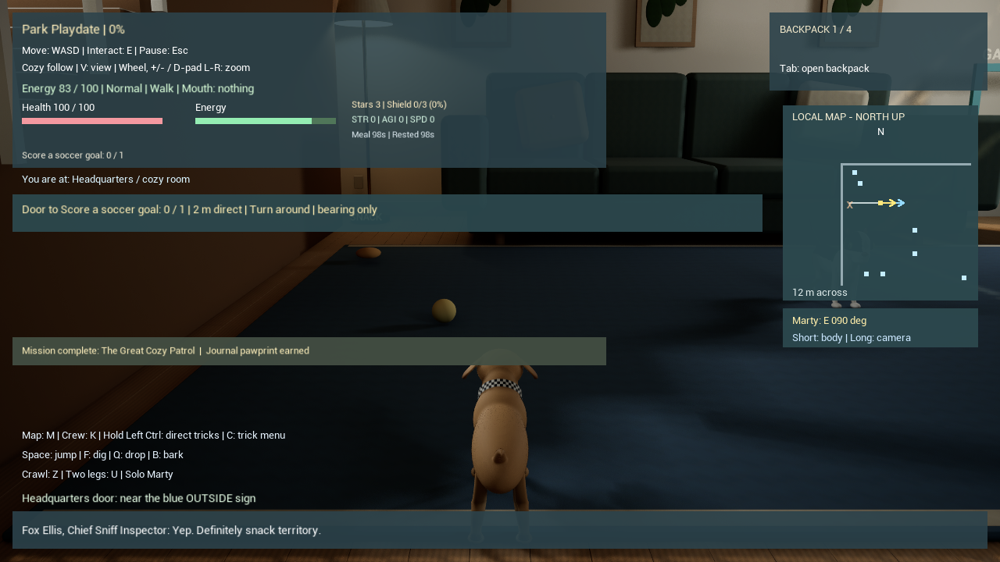

# Codename .... Cheweenie — optional open missions

Development source, November 14, 2026. Built on merged cumulative main, including the articulated dogs/cats and opt-in Halloween. This adds an open-ended mission journal to the solo game. It does not claim a seamless open-world campaign or outdoor multiplayer.

Explore at your own pace. All eight missions are available together, with no acceptance chain or mission deadline. Progress counts while a mission is unpinned or its HUD tracker is hidden. The existing baseball activity still has its own timed base-running rules.

| Mission | Completion |
| --- | --- |
| A Nose for the Neighbourhood | Visit the park and school in either order |
| Hello, Neighbour! | Greet four different dogs |
| The Cozy Crew | Head bump with Lakitu and Rio |
| Rainbow Guy's Day Out | Carry Rainbow Guy, then stow him in the backpack |
| Chief Sniff Inspector | Dig in all three patches around the yard and park |
| A Little Cheeween Cozy | Enjoy a kitchen meal and earn a bed-rest bonus |
| Park Playdate | Score soccer, finish a baseball run and score a basket |
| The Great Cozy Patrol | Finish the original golden-snack/cat/blanket adventure |

Press **J**, or choose **Missions & progress** from the title/pause menu. Use arrows/D-pad, Enter/A-Cross and Backspace/B-Circle; Esc also returns. Clicking a row works too. Pin one mission to display its title, percent and next objective; pinning sets the map to the mission destination when one exists. Map/route/compass switches and manual map destinations remain available. Training, the hockey story and explicitly enabled Halloween keep their existing activity guidance.

The journal shows each objective, overall percentage, completed history and a permanent completion pawprint. Completion produces a non-blocking notice and keeps free play available. Pawprints are cosmetic journal milestones, separate from praise stars and upgrades. There is no repeated reward farming. **New patrol resets only the original patrol**, preserving the journal's completed history and other optional mission progress.

New save fields use stable names and preserve version-1 profiles. Existing dog greetings, cat bonds, dug patches, carried/stowed Rainbow Guy, active earned care bonuses and completed patrols receive credit when first playing. Past visits or sports scores that were never saved cannot be invented; those start counting from this update. Seasonal activation remains off on every launch. Solo journal progress is not replicated between LAN players. If an activity feature was switched off, enable it in Controls before doing the associated mission.

## Validation

Native UE 5.8.4 Editor compilation passed. **400 final real-map assertions passed**: 37 journal/restart, 32 original patrol/restart, 67 navigation/restart, 37 sports, 39 cozy care/upgrades/restart, 37 cat companions/restart, 32 dog NPC, 29 mode hub, 17 hockey, 20 movement and 53 rendered seasonal/restart. Input was synthetic keyboard/gamepad; journal tests include explicit position, saved-action-state and legacy-field fixtures. Sports credit was separately verified from actual scores and a complete base circuit.

Four final captures were reviewed: completed journal, compact tracker, ordinary title and explicitly opened Halloween menu. The acceptance journal's seven completed missions are fixture data, not owner progress. All 18 final logs had no Error/Fatal, material-compilation fallback or VSM-overflow matches. [Actual reports, source/native hashes and iteration notes](evidence/ue5-open-missions.json).

The first journal fixture missed a release frame between confirm devices and expected the park waypoint before leaving the house; its cascading failures are retained. The corrected 30-check play and seven-check reload runs passed. Visual review found tracker/location/hint collisions, which were corrected and reviewed again. An initial headless seasonal texture-size check failed; the asset matched main and the rendered 41-check play plus both six-check restart paths passed. No failed initial checks are counted as passing.

Physical devices, a new standalone package, separate-PC networking and performance improvements remain unverified. Desktop packages and Unity remain unchanged.

The initial clean-build attempt exposed a pre-existing first-include ordering issue in HockeySurprise.cpp and Unreal's engine-wide Live Coding guard. The header order was corrected. The isolated project is built with -NoHotReloadFromIDE so the separate owner's main-game process can remain open; no loaded owner module is replaced.

Commands:

~~~powershell
& ./Unreal/UE5MovementLab/TEST_MISSIONS.ps1 -Render
& ./Unreal/UE5MovementLab/TEST_PARK_SPORTS.ps1
& ./Unreal/UE5MovementLab/TEST_ADVENTURE.ps1
& ./Unreal/UE5MovementLab/TEST_NAVIGATION.ps1
& ./Unreal/UE5MovementLab/TEST_HOME.ps1
& ./Unreal/UE5MovementLab/TEST_COMPANIONS.ps1
& ./Unreal/UE5MovementLab/TEST_HOCKEY.ps1
& ./Unreal/UE5MovementLab/TEST_FESTIVAL.ps1
& ./Unreal/UE5MovementLab/TEST.ps1
~~~
