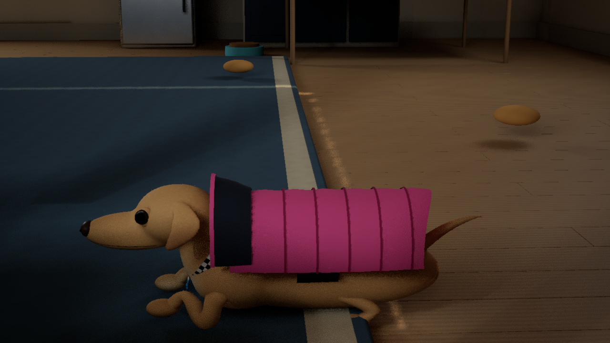
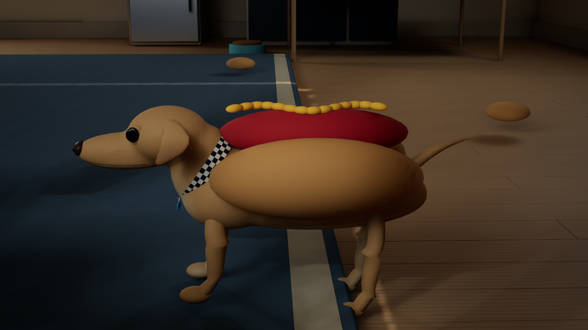
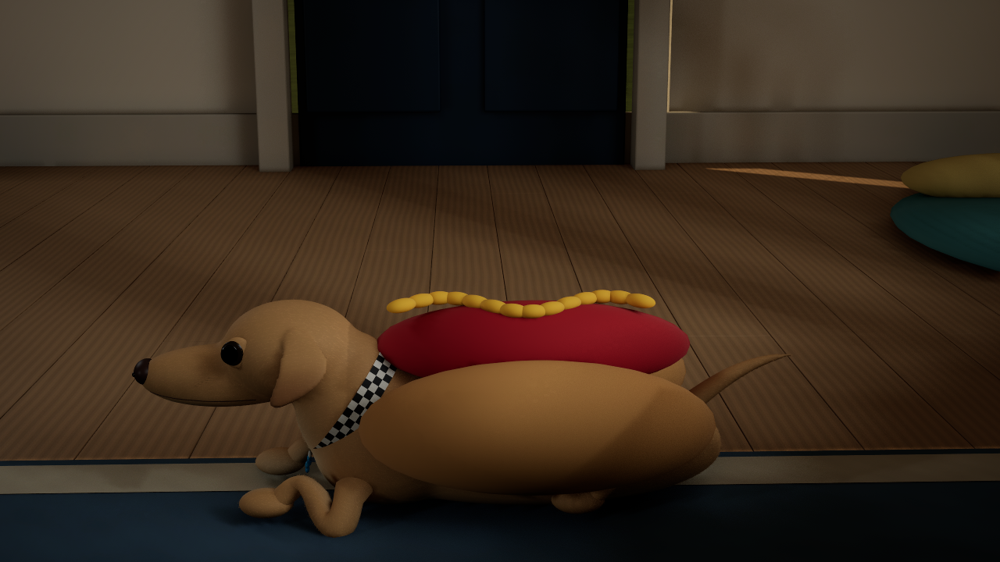

# Codename .... Cheweenie wardrobe attachment optimization

Development source, 2026-11-11. This focused change continues the cumulative 0.16 adventure in `Validation/SportsParkReview`, on `codex/wardrobe-attachment-cache`. Desktop packages have not been replaced.

## Change

Jackets and Marty costumes previously searched the reference skeleton, walked its spine-parent hierarchy and inverted the same bind transform every rendered update. `FWardrobeAttachment` now computes that reference offset once per skinned asset for each wearer. Live spine poses still update every frame, preserving animated clothing. Static cat outfits retain their existing attachment path.

The cache keys on the mesh asset rather than the poseable component: Low, Medium and High fur reuse the component while changing its mesh. Switching meshes rebuilds the offset. Missing meshes safely skip updates; missing spine bones cache a negative result. Weak asset references avoid retaining an unused mesh. Runtime reference skeletons are treated as immutable; editing a skeleton in place requires restarting play.

This removes repeated reference-pose work; it does not establish an FPS improvement or qualify the whole-game performance gate.

## Verification

The native UE 5.8.4 Editor target compiled successfully. Six new real-map assertions compare all three real fur meshes with the original uncached calculation, verify one build per mesh across 64 repeated resolutions, and exercise missing-mesh, missing-spine and valid-mesh recovery.

The first rendered run passed the six cache assertions but failed two existing immediate raincoat-geometry assertions. The test read geometry in the same input stage that changed the saved selection. A separate stage now allows the pawn to apply that selection before checking geometry, materials and face winding. The final runner requires all 27 play assertions, including the new cache checks.

Final real-map validation passed **193 assertions**: 27 jacket/cache, three jacket restart, 51 costume, three costume restart, 46 local co-op host, 43 local co-op guest and 20 basic movement. Jacket/costume play used offscreen DX12 at 1280×720; restart, local co-op and movement checks were headless. All final runtime logs passed the Error/Fatal, material-fallback and VSM-overflow scan. Six actual captures were reviewed; three are retained below. Reports and binary/source hashes are recorded in [the evidence summary](evidence/ue5-wardrobe-optimization.json).

Input is synthetic keyboard/gamepad; physical controllers, separate-PC networking, comparative frame timings and a new standalone package remain unverified. No FPS gain is claimed. Unity checks were not rerun because its source, assets and settings were unchanged.





Run from the integration checkout:

```powershell
& ./Unreal/UE5MovementLab/BUILD.ps1
& ./Unreal/UE5MovementLab/TEST_JACKETS.ps1 -Render
& ./Unreal/UE5MovementLab/TEST_COSTUMES.ps1 -Render
& ./Unreal/UE5MovementLab/TEST_COOP.ps1 -Port 19271
& ./Unreal/UE5MovementLab/TEST.ps1
```

Unity, the independent content preview, owner progress and desktop launchers are outside this change.
